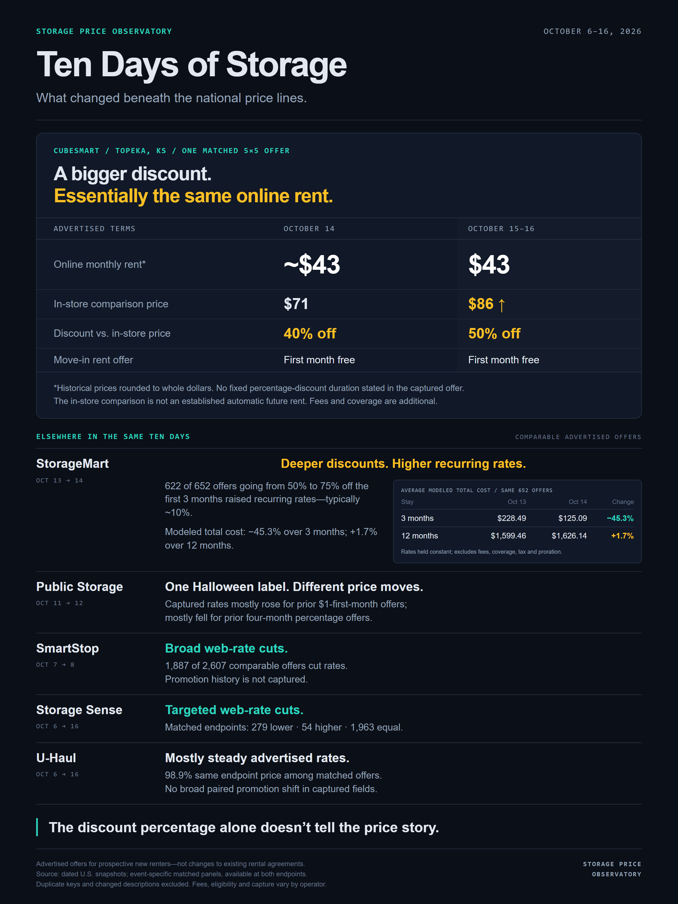

# Storage Price Observatory

A dated record of advertised U.S. self-storage offers across six national operators
and an independent-operator pilot. Completed snapshots are retained so pricing
and promotion findings can be checked against their source observations.

**[Read the research](#latest-research) · [Explore the dashboard](https://braedenkeena.pages.dev/storage/dashboard) · [Check coverage](#what-is-collected)**

**This repository retains the raw daily history.** The snapshots are large;
use GitHub's file browser to inspect individual studies without downloading everything.
A shallow clone reduces Git history but still downloads all tracked snapshot files:

```bash
git clone --depth 1 https://github.com/itshumpf/storage-directory
```

**Published write-up:** https://braedenkeena.pages.dev/storage/
**Dashboard:** https://braedenkeena.pages.dev/storage/dashboard

(Two earlier homes are dead ends: `findstorage.netlify.app` is gone, and
`findstorage.pages.dev` is the retired directory, frozen with a sunset notice
at 25 August 2026.)

## Latest research

### Ten Days of Storage — October 6–16, 2026



The national price lines conceal different changes in online rates, comparison
prices and introductory discounts. These are offers for prospective new renters,
not observations of changes to existing rental agreements.

| Study | Finding | Evidence and method |
|---|---|---|
| CubeSmart | At a Topeka 5×5, online rent stayed around $43 while the in-store comparison rose from $71 to $86 and the advertised discount grew from 40% to 50%. First Month Free remained attached. | [Discount mechanics](analysis/cubesmart_discount_mechanics_2026-10-17/README.md) |
| StorageMart | On October 14, 622 of 652 comparable available offers gaining 75% off the first three months also raised their recurring web rate. | [Matched-offer study](analysis/storagemart_deep_dive_2026-10-17/README.md) |
| Cross-operator | Public Storage's Halloween offers show opposing captured-rate moves; SmartStop and Storage Sense show cuts; U-Haul's matched rates are mostly steady. | [Comparison and capture limitations](analysis/cross_brand_hidden_2026-10-17/README.md) |

The image uses October 6–16 endpoints and event-specific panels inside that window.
The supporting reports also include broader context through October 17; their
dates and denominators are stated separately. CubeSmart's three-day panel of
6,480 offers differs from the earlier four-day panel of 6,250 offers.

Historical CubeSmart prices are rounded to whole dollars. Its percentage discount
is already reflected in the online price and compares it with the in-store price;
First Month Free is a separate component. The comparison price is not established
as an automatic future tenant rate. StorageMart's percentage terms instead specify
the first three months. SmartStop's blank promotion fields reflect a capture gap.
These observations do not establish realized tenant spending, occupancy, intent,
or coordination between operators.

**Reproduce offline from the repository root** (Node.js 22; built-in modules only):

```bash
node analysis/cubesmart_discount_mechanics_2026-10-17.cjs
node analysis/storagemart_deep_dive_2026-10-17.cjs
node --max-old-space-size=4096 analysis/cross_brand_hidden_2026-10-17.cjs
node analysis/cross_brand_hidden_2026-10-17/events.cjs
```

These commands read existing snapshots and write derived results; they do not
collect live data. Each study includes source hashes, eligibility rules and
offer-level output. The cross-operator scan requires snapshots through October 17.
[Editable graphic](media_exports/ten_days_of_storage.html).

### Verify a daily price diff

`verify_day.py` reads two raw snapshots and diffs them on `(store_id, sku)`.
No database, no pipeline, nothing cached. This is a basic price diff: it does
not exclude duplicate identities or changed descriptions and does not compare
promotions. Use the study scripts above to reproduce the stricter research panels:

```
$ python verify_day.py publicstorage 2026-09-22 2026-09-23
publicstorage  2026-09-22 -> 2026-09-23
  stores              4,608 -> 4,611
  SKUs in both days  55,008
  price changes      46,023  (83.67% of panel)
    up               23,282
    down             22,741
  unchanged           8,985
  SKUs added          2,718
  SKUs dropped        2,742
```

For a historical example of a quiet day:

```
$ python verify_day.py publicstorage 2026-10-03 2026-10-04
  SKUs in both days  62,873
  price changes           0  (0.00% of panel)
  unchanged          62,873
  SKUs added            726
  SKUs dropped          900
```

This Public Storage example contrasts a broad repricing day with a quiet day.
It is not a universal pattern for every operator. Daily observations distinguish
price events from changing available inventory; weekly or monthly samples can
miss the intervening changes.

## The sealed prediction

[`2026-09-15-q3-prediction-and-ledger-gap.md`](2026-09-15-q3-prediction-and-ledger-gap.md)
is a pre-registration, committed to this repository on 18 September 2026 —
before the quarter closed and before any result existed. It predicts two Public
Storage Q3 line items and one Q4 line item from the advertised-price record
alone, and it states its own falsification conditions in advance:

- **P1** — Q3 promotional discounts given will still be up year over year, but
  below Q2's +16.1% growth. *Falsified at or above +16.1%, or on an outright
  decline.*
- **P2** — Q3 new-customer contract rate growth will come in below +1.6% year
  over year. *Falsified at or above +1.6%.*
- **P3** — Q4 new-customer contract rates will be flat or negative year over
  year. *Falsified if positive.* This one contradicts management guidance.

It also writes down, in advance, what a failure would and would not establish,
which measurement caveats could explain a miss without any defect in the data,
and two reported metrics that are deliberately **out of scope** because this
dataset cannot see them.

The git commit date is the point. Anyone can check that the predictions predate
the results. Section 6 of that file also records the project's terms-of-use
history and what was stopped, when, and why.

## How this got here

- **2026-04-29 → 2026-08-25 — FindStorage.** Started as a store-ID finder,
  because a five-digit site number that staff needed daily was not published
  anywhere. It grew into a consumer directory of Public Storage locations with
  unit-level pricing. **That product is retired.** Its site is an archive frozen
  at 25 August 2026; its headline figures are frozen at that date and reported
  separately from anything here.
- **September 2026 — one brand became seven.** The collection generalised to
  U-Haul, CubeSmart, Storage Sense, StorageMart, SmartStop and an independent
  set. The rate log is keyed on `(brand, sku)`, the database carries a composite
  primary key, and each operator's own field names are stored untranslated
  rather than mapped into a lowest-common-denominator schema.
- **2026-10 — collection moved off GitHub Actions.** The repository went private
  and Actions minutes metered out immediately. Collection now runs locally from
  `collect_all.ps1`. The workflow files under `.github/workflows/` are retired
  and kept only for reference — **do not diagnose from them.**

The directory did not survive. The measurement did, and this repository is the
measurement.

## What is collected

Coverage checked October 17, 2026. Counts include completed dated JSON files only.

| Collection | Snapshots | First | Most recent | Days captured |
|---|---|---|---|---:|
| Public Storage | `history/publicstorage/<date>.json` | 2026-09-01 | 2026-10-17 | 47 |
| U-Haul | `history/uhaul/<date>.json` | 2026-09-04 | 2026-10-17 | 44 |
| CubeSmart | `history/cubesmart/<date>.json` | 2026-09-01 | 2026-10-17 | 46 |
| Storage Sense | `history/storagesense/<date>.json` | 2026-09-02 | 2026-10-17 | 46 |
| StorageMart | `history/storagemart/<date>.json` | 2026-09-05 | 2026-10-17 | 43 |
| SmartStop | `history/smartstop/<date>.json` | 2026-09-09 | 2026-10-17 | 39 |
| Independent pilot | `history/independent/<date>.json` | 2026-09-10 | 2026-10-13 | 27 |

Missing observations remain missing; no daily snapshot is interpolated.
CubeSmart is missing September 8. The independent pilot is missing September 11,
26 and 29, plus October 2, 3, 11 and 12 within its observed range; its latest
complete snapshot is October 13. The other five series have no calendar gaps
within their listed ranges. Independents are excluded from the October 17
current-data merge because that snapshot exceeds the three-day freshness limit.
Daily discovery catalogs are retained separately from completed price snapshots.
Extra Space has no complete production time series and is excluded from these counts.
Pre-September Public Storage history is represented by monthly aggregates and
repository history rather than these dated JSON files.

A defining goal of the original directory, still true of the collection: it
lists **every** store with its 5-digit site number, *including sold-out
locations*. Public Storage removes full stores from its own sitemaps (~900
stores are missing from them), so the pipeline recovers those through city-page
map markers, per-store page fetches, a carry-forward check against the previous
dataset, and a weekly exhaustive probe of the numeric store-ID space.

## How collection runs

One process per brand, in parallel, launched by hand:

```powershell
PS C:\dev\storagedir> .\collect_all.ps1 -IncludePublicStorage
```

Each host is hit by exactly one process, so parallel is no less polite than
serial, and wall-clock is the slowest collector rather than the sum of seven.
A collector that fails leaves its partial file behind and is simply absent from
that day's merge; the others still land. Every crawler resumes from a checkpoint
on retry.

**Retry is deliberately manual.** Automatically re-hammering a host that just
failed you is the one behaviour that turns a polite crawler impolite without
anyone deciding to.

## What it does

- **Directory** — searchable, filterable card/map views of every facility: address, phone, site number, and current advertised unit prices with promotions. Location-aware search (city/state/zip/radius) plus free-text search, built with vanilla JavaScript and Leaflet marker clustering.
- **Daily data pipeline** — `collect_all.ps1` re-scrapes every brand, rebuilds the SQLite analysis database, regenerates the insights report, and writes the results. (Through roughly September 2026 this ran as a scheduled GitHub Actions job; see "How this got here".)
- **Market analysis** — a SQL analysis suite over the dataset: state-by-state 10x10 pricing, price per square foot, in-city price variance, live inventory and scarcity, true promotional move-in cost, store clustering, per-capita saturation, and the vehicle-storage market. Results are published as a self-contained report page.
- **Time series** — every daily run appends per-store aggregates (advertised availability, cheapest 10x10, median price) to an append-only history log, and regenerates a trends page: national inventory and price charts, the fastest-renting stores, and the biggest price hikes and cuts. History was backfilled from git snapshots of the dataset, so the series starts April 29, 2026.
- **Pricing-model analysis** — the scraper captures each unit's physical attributes (climate control, floor, drive-up access) and advertised price range from store-page structured data. Pairing same-size units at the same store isolates what each attribute costs, and bucketing prices by remaining inventory exposes the scarcity gradient. One negative result worth reading: the advertised min-max "range" turned out to be mechanically price ±20% on every unit — a disclaimer construct, not a pricing envelope — so it is documented as such rather than tracked. Existing-tenant rate increases (ECRI) are not public and are explicitly out of scope; this models new-customer street rates only.
- **Derived datasets** — beyond the directory itself, the pipeline maintains: a per-SKU **rate-change event log** (every street-rate move and promo switch, daily), **state-by-size demand aggregates** (size-level availability and pricing over time), a **coming-soon store pipeline** (openings tracker fed by the weekly ID probe), **store review ratings** (from page structured data), and an **affordability join** against IRS income data by zip.

## Architecture

```
publicstorage.com (city pages + XML sitemaps + pricing API)
        │
        ▼
daily_scraper.py ──────────► enriched_locations.json
  (collect_all.ps1, daily)         │
        │                          ├──► index.html (client-side directory)
        ▼                          │
analysis/load_storage.py ──► storage.db
        │
        ▼
analysis/analyze_storage.py ──► insights.html (published report)
```

Discovery runs in layered passes, because no single source is complete:

1. **City pages** (~1,370 from the category sitemap) — embedded map-marker data is the primary source and the only one that reliably includes delisted/sold-out stores.
2. **Product sitemap** — stub records for anything the markers missed.
3. **Zip-code sweep** — search-results gap filler that also merges missing fields into sparse records.
4. **Site-number backfill** — stores still missing their 5-digit code get their own page fetched.
5. **Carry-forward** — previously known stores that discovery missed stay in the dataset as long as their page is still live; only 404s drop out.
6. **Deep ID probe** (weekly, `--deep`) — exhaustively probes the numeric store-ID space via canonical redirects; a candidate only counts if its own page confirms it with matching marker data, which filters out coming-soon placeholders and lingering redirects for closed stores.
7. **Pricing** — batched lookups against the pricing API for all stores.

The scraper has safety rails: it aborts without writing if it finds fewer than a floor count of stores, or more than a 10% drop from the previous run, so a partial scrape can never clobber good data. Requests are rate-limited (0.4s delay, batched pricing lookups).

## Project structure

| Path | Purpose |
|---|---|
| `verify_day.py` | **Start here.** Re-derives one day's price changes from two raw snapshots — no database, no pipeline, no cached numbers |
| `collect_all.ps1` | The orchestrator: one process per brand, parallel, checkpointed, manual retry |
| `index.html` | The directory frontend (single file, no build step) |
| `daily_scraper.py` | Production Public Storage scraper, run daily by collect_all.ps1 |
| `uhaul_scraper.py` | Slow, resumable, all-or-nothing U.S. U-Haul owned/managed daily snapshot collector |
| `uhaul_parser.py` | U-Haul sitemap and server-rendered room parser |
| `all_locations.json` | The combined dataset: every operator, unit-level pricing |
| `enriched_locations.json` | The Public Storage slice of it (4,618 stores on 2026-10-04) |
| `analysis/load_storage.py` | Loads the dataset into a normalized SQLite database |
| `analysis/run_queries.py` | Core analysis query set (run all, or one by number) |
| `analysis/analyze_storage.py` | Data-quality audit + full analysis + report generator |
| `analysis/update_history.py` | Appends per-store daily aggregates + state-size demand aggregates |
| `analysis/update_rate_log.py` | Appends per-SKU price/promo change events to `history/rate_changes.csv` |
| `analysis/build_trends.py` | Generates the daily trends page from the history log |
| `history/<brand>/<date>.json` | The raw daily snapshots — the evidence every published figure is derived from |
| `history/*.csv` | Append-only aggregates: store-level daily series, size demand, rate-change events |
| `data/zip_income.csv` | IRS SOI 2022 average income per tax return, for the affordability analysis |
| `legacy/` | One-off Colab scripts used to bootstrap the original dataset |
| `.github/workflows/` | **Retired.** Kept for reference; not the live system |

## Running it locally

```bash
# Check a published figure against the raw snapshots.
# Standard library only — no install, no network, no database.
python verify_day.py publicstorage 2026-09-22 2026-09-23

# Everything below needs the dependencies:
pip install -r requirements.txt

# Scrape a fresh dataset (~25-30 min, rate-limited)
python daily_scraper.py

# Separate full U-Haul snapshot (~3+ hours at a five-second request floor)
python uhaul_scraper.py

# Build the analysis database and run the query suite
python analysis/load_storage.py enriched_locations.json
python analysis/run_queries.py

# Generate the insights report
python analysis/analyze_storage.py

# Serve the site
python -m http.server
```

## Tech

Python (requests, BeautifulSoup), SQLite, vanilla JavaScript, Leaflet, PowerShell, Cloudflare Pages.

## Data & fair-use note

This is an independent research/portfolio project, not affiliated with or endorsed by Public Storage. All data is collected from publicly advertised rates at conservative request rates, and is presented with links back to the original listings.

---

Built by Braeden Keena.

## Multi-operator pipeline (September 2026)

Collection now covers seven operators. Each collector still owns its own
brand; `storage_pipeline.py` is the seam that joins them.

| Brand | Collector | Snapshot lands in |
|---|---|---|
| Public Storage | `daily_scraper.py` via `storage_pipeline.py run` | `enriched_locations.json` → `history/publicstorage/<date>.json` |
| CubeSmart | `cubesmart_scraper.py` via `storage_pipeline.py run` | `history/cubesmart/<date>.json` |
| Storage Sense | `storagesense_scraper.py` via `storage_pipeline.py run` | `history/storagesense/<date>.json` |
| U-Haul | `uhaul_scraper.py` via `storage_pipeline.py run` | `history/uhaul/<date>.json` |
| StorageMart | `storagemart_scraper.py` via `storage_pipeline.py run` | `history/storagemart/<date>.json` |
| SmartStop | `smartstop_scraper.py` via `storage_pipeline.py run` | `history/smartstop/<date>.json` |
| Independent | `independent_scraper.py` via `storage_pipeline.py run` | `history/independent/<date>.json` |

All seven emit the same record shape, so one immutable dated snapshot per brand per day is
the whole contract. After the collectors finish, `collect_all.ps1` runs:

```bash
python storage_pipeline.py daily      # import -> merge -> record -> build-dashboard
python storage_pipeline.py status     # freshness of every brand at a glance
```

which maintains `history/combined/` (cross-brand daily store aggregates, state × size
aggregates, and a per-SKU rate-change log — all brand-tagged, all idempotent) and writes
`dashboard-data.json` for the dashboard:

```bash
python -m http.server 8777      # then open http://localhost:8777/dashboard.html
```

The dashboard is the replacement for the sunset FindStorage site: overview tiles per brand,
size-by-size price comparison, state table, store search with map and per-size detail,
trends, and a rate-change feed. It is a single file with no build step, reads only
`dashboard-data.json`, and is published at
https://braedenkeena.pages.dev/storage/dashboard

### The directory and reports on the combined dataset (2026-09-09)

The original directory and reports now run on the combined dataset:

- `index.html` reads `all_locations.json` (every operator; falls back to `enriched_locations.json`), with operator chips, brand-coloured cards and markers, and street rates struck through where an operator publishes one.
- `analysis/build_trends.py` and `analysis/build_store_history.py` read `history/combined/` (falling back to the legacy files) and add per-operator chart sections; store-history popups cover every operator's stores.
- `pricer.html` — one map, all operators: search a place, pick a size, see every store in range ranked by price with per-operator medians.
- `dashboard.html` — the internal monitor (freshness, comparisons, trends, rate-change feed).

If the Cloudflare/Netlify build copies specific files into `dist/`, add `all_locations.json`, `dashboard-data.json`, `dashboard.html` and `pricer.html` to that list.

### SmartStop collection policy

SmartStop is discovered fresh each day from its declared XML sitemap. The sitemap currently
contains 275 facility pages: 213 U.S. locations are collected and 62 Canadian locations are
deliberately excluded. The collector fetches one server-rendered facility page per U.S. location, never runs faster than the declared
10-second crawl delay, stops on the first 403/429 response, checkpoints progress, and only
publishes after the complete daily catalog passes count and drop-safety checks. SmartStop's
Schema.org feed exposes advertised offers, not physical vacancy totals, so the dashboard labels
that inventory signal as **offers advertised**.

### Independent-operator platform census

The long-tail intake tools deliberately separate physical-property identity from operator and
software-vendor identity:

- `storable_adapter.py` normalizes the common Storable/storEDGE facility and unit-group model;
  StorageMart now uses this shared core while retaining its own discovery and page validation.
- `platform_probe.py` classifies only URLs supplied to it. It fetches robots.txt first, refuses
  to fetch a disallowed page, waits at least 10 seconds, and makes at most one page request.
- `independent_registry.py` deduplicates physical facilities by normalized address (or coordinates
  when no usable address exists) while retaining operator aliases, platforms, and source URLs.
- `independent_operators.json` is the operator registry. Batches 01 and 02 contain 50 disabled
  discovery records; Batch 02's 25 new entries remain plain candidates until live review. A platform
  hint is not confirmation. An operator cannot be enabled until its robots,
  terms, representative-page behavior, parser fixture, and daily request budget have been reviewed.

Example classification—the command will not bypass a missing or restrictive robots file:

```powershell
python platform_probe.py https://operator.example/units --out private/operator-probe.json
```

The independent cohort has a separate, fail-closed runner. Its default command is a zero-network
plan; `probe` refreshes robots.txt and then requests one representative page per host after a
minimum ten-second delay. Probe reports never become price snapshots.

New operators can be dropped into `independent_candidates.txt`, one URL per line (or
`Operator Name | URL`). Preview with `python independent_intake.py`; use
`python independent_intake.py --apply` to deduplicate by domain and add only new entries to the
registry. Every imported entry is disabled and starts at `candidate`, so text input alone can
never authorize a request.

Before a page probe, `independent_robots.py` performs a checkpointed robots-only audit of disabled
candidates. It makes exactly one `/robots.txt` request per domain and never requests a homepage,
sitemap, facility page, or inventory endpoint. Redirects, missing files, TLS failures, and
refusals remain review items rather than being followed automatically.

```powershell
python independent_scraper.py plan
python independent_robots.py
python independent_scraper.py probe --operator atlantic_self_storage
python independent_scraper.py catalog
python independent_scraper.py smoke
```

`catalog` reads the same-day, robots-derived URLs in `independent_sitemaps.json`, follows only
same-host sitemap indexes at the ten-second request floor, and freezes the complete URL lists in
`history/independent/catalog/`. It does not request facility pages or publish a price snapshot.
`smoke` then selects at most one canonical facility URL per operator from that same-day catalog,
refreshes robots.txt, waits at least ten seconds, and records parser diagnostics without publishing.
Its same-day report is resumable: an attempted host is never automatically retried.

The first full independent pilot is deliberately separate from `collect_all.ps1` until it has
produced and validated its first complete snapshot. It refreshes each host's robots.txt, requires
the expected sitemap still to be declared there, freezes a daily per-operator catalog, then
checkpoints every facility page. A 403/429 stops the whole run for the day; any other failure needs
an explicit `--retry-failed`; and no snapshot is published until every selected URL parses.

```powershell
python independent_full_scraper.py --plan
python independent_full_scraper.py
```

Full collection remains intentionally unavailable until a probe confirms the adapter and a daily
facility catalog plus completeness floor have been defined for that operator.

### Extra Space research status

Extra Space is not included in the production snapshot series or current
comparisons. Limited local pilot observations are incomplete; a subsequent
collection attempt stopped on an access refusal. Pilot archives and operational
notes are separate from this research release.
